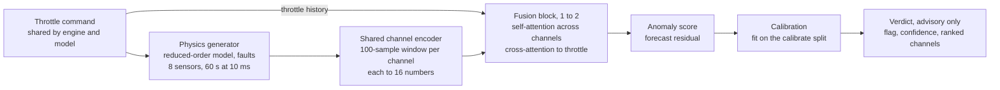

# Architecture

What lives where and how data flows. For *why* the system is designed this way, see the [design rationale](design-doc.md).

## Pipeline



The generator produces telemetry from a throttle command. Each channel's window is encoded into 16 numbers, and the fusion block weighs the channels against each other and against the throttle history to forecast what each channel should do next. The gap between forecast and reality becomes the anomaly score, which is calibrated into an advisory verdict.

## Repo layout

```
contracts.py    frozen constants and the Run, FaultLabel and Verdict types (single source of truth)
generator/      physics model, fault injection, dataset splits
model/          encoder, fusion block, training
evaluation/     redline and persistence baselines, metrics harness
tests/          contract tests and per-phase exit tests
runs/           one folder per run: config and metrics committed, everything else ignored
docs/           design rationale, architecture, two-week plan, build log
```

## Frozen contracts

Values live in `contracts.py`. Changing one requires a decision-log entry below.

| Contract | Code | Value |
| --- | --- | --- |
| Channels, fixed order | `CHANNELS` | `chamber_pressure`, `turbopump_speed`, `turbopump_vibration`, `bearing_temp`, `nozzle_temp`, `coolant_flow`, `feed_pressure`, `mixture_ratio` |
| Command | `COMMANDS` | `throttle` only |
| Sample interval | `DT_S` | 0.01 s (10 ms) |
| Run length | `RUN_S` | 60 s |
| Steps per run | `N_STEPS` | 6000 |
| Encoder window | `WINDOW` | 100 samples (1 s) |
| Embedding size | `D_EMBED` | 16 numbers per channel, so (batch, 8, 16) |
| Encoder weights | — | Shared across all 8 channels, plus a learned channel-ID embedding. Each channel normalized with train-split statistics |
| Fusion | — | 1 to 2 transformer blocks, 4 heads, feed-forward 16 → 64 → 16 |
| Training objective | — | Forecast all 8 channels 10 to 20 samples ahead (horizon tuned on validation) |
| Run layout | `Run` | `throttle` (6000,) and `sensors` (6000, 8) in `CHANNELS` order, time first, kept separate. Plus `seed` and `fault` (a `FaultLabel`, or None when healthy). Shapes validated on creation. Arrays are copied and read-only |
| Fault ground truth | `FaultLabel` | `kind` (`bearing_wear` only), `onset_s` (0 to 60 s), `rate` (positive), `channels` (at least one, all in `CHANNELS`). Validated on creation. Read by evaluation only, never by the model |
| Output | `Verdict` | `flag`, `confidence` (0 to 1), `ranked_channels`. Validated on creation, round-trips through JSON |

Channel code names map to the names used in the two-week plan and the design docs:

| Index | Code name | Plan name |
| --- | --- | --- |
| 0 | `chamber_pressure` | chamber pressure |
| 1 | `turbopump_speed` | turbopump speed |
| 2 | `turbopump_vibration` | turbopump vibration |
| 3 | `bearing_temp` | bearing temp |
| 4 | `nozzle_temp` | nozzle/coolant temp |
| 5 | `coolant_flow` | coolant flow |
| 6 | `feed_pressure` | feed-line pressure |
| 7 | `mixture_ratio` | mixture ratio |

## Data discipline

- Four disjoint splits (train, validation, calibrate, test) from separate seed ranges.
- Train holds healthy runs only. Validation, calibrate and test mix healthy and faulted runs.
- The test split is opened once.
- The model sees telemetry and the throttle command only. The injected fault never reaches it.
- Normalization statistics come from the train split only.

The reasoning is in floor commitment 2 of the [design rationale](design-doc.md).

## Seams

- **Generator ↔ real telemetry:** both produce a `Run` of the same shape (throttle `(6000,)` + sensors `(6000, 8)`), so either can feed the model.
- **Encoders are swappable:** anything that turns a channel's 100-sample window into 16 numbers fits. Each channel maps to an encoder. Today all eight point to the same shared one, and the vibration channel is the first candidate for its own.

## Pipeline details

Coming once the model exists (Nov 16).

## Decision log

| Date | Decision | Why |
| --- | --- | --- |
| 2026-11-10 | Five floor commitments, adding "the verdict must be legible" | An output a human can't read under pressure gets ignored |
| 2026-11-10 | d = 16, window = 100 samples, runs of 60 s at 10 ms, throttle the only command | Values from the How It Works book. Mixture ratio is a sensor, not a command |
| 2026-11-10 | Training objective: forecast all 8 channels 10 to 20 samples ahead | Forces the model to read the throttle, so commanded changes don't raise false alarms. One step ahead can be passed by copying the last value |
| 2026-11-10 | Encoders share weights, with a channel-ID embedding and per-channel normalization | The case study's "same uniform encoder" with channel tags. Each channel still maps to one token, so attention stays per sensor |
| 2026-11-10 | Channel code names `nozzle_temp` and `feed_pressure` | Shorter names for the plan's "nozzle/coolant temp" and "feed-line pressure", mapped in the table above |
| 2026-11-10 | In `runs/`, commit each run's `config.*` (with seed) and `metrics.*`, ignore the rest | Small files a reviewer needs to reproduce a number. Everything else is large and regenerable |
| 2026-11-11 | Redlines come from the physics, set before looking at any runs, one upper limit per channel | Real redlines come from what the hardware survives. When a fault must stay sub-threshold, tune the fault, never the redlines |
| 2026-11-11 | Each kind of randomness gets its own stream, `default_rng([seed, id])`: throttle 1, engine 2, noise 3, fault 4. Never renumber | Plain `default_rng(seed)` in two places gives identical numbers. Ids start at 1 because `[seed, 0]` equals a plain seed |
| 2026-11-11 | `simulate(noise=False)` turns off only sensor noise | Step and lag tests run on clean physics while every seed stays a distinct engine |
| 2026-11-11 | `Run` stores `throttle` (6000,) and `sensors` (6000, 8) as separate arrays | `sensors[:, i]` is always `CHANNELS[i]`, and throttle enters the model through cross-attention, not as a ninth channel |
| 2026-11-12 | Redlines 20% above each channel's rated full-throttle value (temperatures in K), upper limits only | A plausible design margin. Healthy headroom over 200 seeds is 8% or more (vibration is tightest), leaving room for a sub-threshold fault |
| 2026-11-12 | Duty cycle: 1 to 2 mid-run throttle steps, at least 8 s apart, each at least 0.1, levels 0.6 to 1.0 | Every run has a commanded change for D7's false-alarm test, with time to settle |
| 2026-11-12 | Engine parameters vary plus or minus 3% per seed, calibration offsets up to 3 noise sigmas (`OFFSET_MAX`), Gaussian noise about 0.5% of rated (vibration 1.5%) | Every seed is a distinct engine, and real calibration errors are often several times the noise. Bounded draws keep redline headroom |
| 2026-11-12 | Engine model: feed ∝ speed², flow = c_flow · √feed, chamber pressure ∝ flow. Bearing and nozzle are heat balances. Nozzle cooling ∝ flow^0.8 plus a 30 s loss to ambient. Mixture ratio constant | Pc follows the pump so pump faults reach it. Linear cooling would cancel the heat input and leave the nozzle flat across throttle. The ambient loss lets the nozzle cool after shutdown (full throttle settles near 750 K, not 790 K). One pump can't imbalance the flows. Limitation: speed, Pc and flow stay exact multiples in healthy runs |
| 2026-11-12 | Bearing wear = mu / healthy mu − 1 acts on bearing heat, speed (× (1 − 0.02 · wear)) and vibration (× (1 + 0.2 · wear)) | Without it, bearing wear moved one channel. At 1.5 times healthy friction it moves seven: speed, Pc and flow −1%, feed −2%, vibration +8%, bearing +18 K, nozzle −1 K. Constants are tuned with onset rate on D3 |
| 2026-11-12 | `Run` gains `fault: FaultLabel \| None = None`. `FaultLabel` holds kind, onset, rate and the channels the fault acts on directly (bearing temp, vibration, speed). Onset bounds are inclusive, 0 to `RUN_S` | The generator writes the label and evaluation reads it, so it is a contract. Defaulting to None keeps every existing healthy `Run` valid. Downstream channels (feed, flow, chamber pressure) move only because speed moves, so they are left out of the ground truth. This choice shapes the Nov 20 attribution check |
| 2026-11-12 | Bearing-wear exit criteria: onset drawn from 10 to 30 s, at least 80% of fault runs cross no redline before onset + 15 s, and by then bearing temp and vibration sit visibly above the healthy twin (floors in the next entry) | Two tests pull in opposite directions and fence the fault into a band: small enough that redlines miss it, big enough that a model has something to see. A do-nothing fault would pass the redline test alone |
| 2026-11-12 | Fault visibility floors per channel: bearing temp 5 sigma, vibration 2 sigma per sample | The vibration redline margin (about 0.14 g above a peak healthy run) is under 5 sigma, so a 5 sigma vibration shift at full throttle would cross the redline. That matches the thesis: supporting channels are subtle alone. Window averaging makes a sustained 2 sigma shift easily detectable |
| 2026-11-12 | Split seed ranges: train 0 to 1,999 (2,000 runs), val 100,000 to 100,399 (400), calibrate 200,000 to 200,299 (300), test 300,000 to 300,399 (400). Train is all healthy. In val, calibrate and test, odd seeds carry bearing wear and even seeds are healthy. Never move a range once datasets exist | Disjoint ranges make overlap impossible by construction, and the 100,000-seed gaps let any split grow without reaching its neighbor. Train stays healthy because the model learns normal behavior only. Alternating seeds give a 50/50 mix in every slice of a split. `fault_for` decides without simulating, so the split tests check every seed in milliseconds |
| 2026-11-12 | Bearing-wear rate drawn from 0.04 to 0.06 per second (`RATE_RANGE`), up from 0.03 | At 0.03, 2 of 50 seeds left vibration just under its 2 sigma floor. Across every faulted run in val, calibrate and test, both floors now hold, and at least 99% stay under every redline until onset + 15 s |
| 2026-11-12 | Calibrate holds faulted runs as well as healthy ones | Keeps both calibration methods open: temperature scaling needs labeled faults, and the empirical-quantile fallback can use the healthy half alone |
| 2026-11-12 | Every contract violation raises `ValueError`. `Run` copies its arrays and marks them read-only. Checks are written so NaN fails them | One error type keeps the tests uniform. `frozen=True` stops reassignment but not in-place edits, so an accidental `run.sensors -= mean` during normalization would silently corrupt a fixed run. Normalization must build new arrays instead |
| 2026-11-13 | Fault magnitudes locked: `RATE_RANGE` = 0.04 to 0.06 per s, `K_VIB` = 0.2, `K_LOAD` = 0.02. A test pins the values | Fixed before any model exists, so the model can't be tuned against a moving fault. The one allowed exception is D4's exit check: if the redline baseline catches most faults early, the faults are too obvious and get retuned on val only, with a new entry here |
| 2026-11-13 | Val, calibrate and test grow to 1,000 runs each (seeds 100,000 to 100,999, 200,000 to 200,999, 300,000 to 300,999), so 500 healthy and 500 faulted per split. Train unchanged. Supersedes the sizes in the 2026-11-12 split entry | With 150 healthy calibrate runs, a threshold at a 2% budget would rest on about 3 runs. 500 healthy runs give 10 allowed false alarms at 2%, enough for a stable threshold. Changed before any evaluation exists, so no results were seen |
| 2026-11-13 | False-alarm budget: at most 2% of healthy runs (60 s each) with any alarm, counted over the whole run, including startup, shutdown and commanded throttle steps. 1% and 5% are pre-registered secondary points. Thresholds are the 98th percentile (99th, 95th) of per-run peak scores over calibrate's 500 healthy runs. Val measures whether the budget holds, and test is used once, on D9. Alarms before onset in faulted runs are reported separately and disqualify that run as a catch, but stay out of the 2% rate. A catch is a first alarm within onset + 15 s. Also reported: false-alarm events per run and detection delay. Headline comparison: orchestrator against redline at the redline's own false-alarm rate. Redlines are fixed, not tuned | 2% is the strictest rate 500 healthy runs measure reliably (10 allowed false alarms). Per-run peaks make the threshold a simple percentile. Counting startup, shutdown and steps keeps a detector from hiding false alarms in transients. Comparing at the redline's own rate stops the reply "of course you catch more if you're allowed more false alarms". All fixed before any model exists |
| 2026-11-13 | Transient window `TRANSIENT_S` = 5 s: a false alarm within 5 s after any commanded throttle change (startup, mid-run steps, shutdown) is also reported as a transient false alarm | The pump settles within about 2.5 s (5 time constants of 0.5 s) and the bearing's time constant is 5 s, so 5 s covers the fast response to a command. Transient false alarms still count toward the 2% budget, and are reported separately so D7 can show what command awareness fixes |
