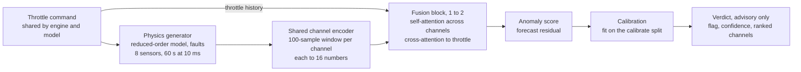

# Architecture

What lives where and how data flows. For *why* the system is designed this way, see the [design rationale](design-doc.md).

## Pipeline



The generator produces telemetry from a throttle command. Each channel's window is encoded into 16 numbers, and the fusion block weighs the channels against each other and against the throttle history to forecast what each channel should do next. The gap between forecast and reality becomes the anomaly score, which is calibrated into an advisory verdict.

## Repo layout

```
contracts.py    frozen constants and the Verdict type (single source of truth)
generator/      physics model, fault injection, dataset splits
model/          encoder, fusion block, training
evaluation/     redline and persistence baselines, metrics harness
tests/          contract tests and per-phase exit tests
docs/           design rationale, architecture, two-week plan
```

## Frozen contracts

Values live in `contracts.py`. Changing one requires a decision-log entry below.

| Contract | Code | Value |
| --- | --- | --- |
| Channels, fixed order | `CHANNELS` | `chamber_pressure`, `turbopump_speed`, `turbopump_vibration`, `bearing_temp`, `nozzle_temp`, `coolant_flow`, `feed_pressure`, `mixture_ratio` |
| Command | `COMMANDS` | `throttle` only |
| Sample interval | `DT_S` | 0.01 s (10 ms) |
| Run length | `RUN_S` | 60 s |
| Steps per run | `N_STEPS` | 6000 |
| Encoder window | `WINDOW` | 100 samples (1 s) |
| Embedding size | `D_EMBED` | 16 numbers per channel, so (batch, 8, 16) |
| Encoder weights | — | Shared across all 8 channels, plus a learned channel-ID embedding; each channel normalized with train-split statistics |
| Fusion | — | 1 to 2 transformer blocks, 4 heads, feed-forward 16 → 64 → 16 |
| Training objective | — | Forecast all 8 channels 10 to 20 samples ahead (horizon tuned on validation) |
| Output | `Verdict` | `flag`, `confidence` (0 to 1), `ranked_channels`; validated on creation, round-trips through JSON |

## Data discipline

- Four disjoint splits (train, validation, calibrate, test) from separate seed ranges.
- The test split is opened once.
- The model sees telemetry and the throttle command only; the injected fault never reaches it.
- Normalization statistics come from the train split only.

The reasoning is in floor commitment 2 of the [design rationale](design-doc.md).

## Seams

- **Generator ↔ real telemetry:** both produce runs of the same shape (1 command + 8 sensors × 6000 steps), so either can feed the model.
- **Encoders are swappable:** anything that turns a channel's 100-sample window into 16 numbers fits. Each channel maps to an encoder; today all eight point to the same shared one, and the vibration channel is the first candidate for its own.

## Pipeline details

Coming once the model exists (Nov 16).

## Decision log

| Date | Decision | Why |
| --- | --- | --- |
| 2026-11-10 | Five floor commitments, adding "the verdict must be legible" | An output a human can't read under pressure gets ignored |
| 2026-11-10 | d = 16, window = 100 samples, runs of 60 s at 10 ms | Values from the How It Works book |
| 2026-11-10 | Throttle is the only command | Per the book; mixture ratio is a sensor |
| 2026-11-10 | Training objective: forecasting, 10 to 20 samples ahead | Forces the model to read the throttle, which prevents false alarms on commanded changes; one step ahead can be passed by copying the last value |
| 2026-11-10 | Encoders share weights, with a channel-ID embedding and per-channel normalization | The case study's "same uniform encoder" with channel tags; the design rationale's "start uniform." Each channel still maps to one token, so attention stays per-sensor |
