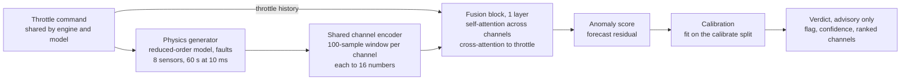

# Architecture

What lives where and how data flows. For *why* the system is designed this way, see the [design rationale](design-doc.md).

## Pipeline



The generator produces telemetry from a throttle command. Each channel's window is encoded into 16 numbers, and the fusion block weighs the channels against each other and against the throttle history to forecast what each channel should do next. The gap between forecast and reality becomes the anomaly score, which is calibrated into an advisory verdict.

## Repo layout

```
contracts.py    frozen constants and the Run, FaultLabel and Verdict types (single source of truth)
generator/      physics model, fault injection, dataset splits
model/          encoder, fusion block, training
evaluation/     redline and persistence baselines, metrics harness
tests/          contract tests and per-phase exit tests
runs/           one folder per run: config and metrics committed, everything else ignored
docs/           design rationale, architecture, two-week plan, build log
```

## Frozen contracts

Values live in `contracts.py`. Changing one requires a decision-log entry below.

| Contract | Code | Value |
| --- | --- | --- |
| Channels, fixed order | `CHANNELS` | `chamber_pressure`, `turbopump_speed`, `turbopump_vibration`, `bearing_temp`, `nozzle_temp`, `coolant_flow`, `feed_pressure`, `mixture_ratio` |
| Command | `COMMANDS` | `throttle` only |
| Sample interval | `DT_S` | 0.01 s (10 ms) |
| Run length | `RUN_S` | 60 s |
| Steps per run | `N_STEPS` | 6000 |
| Encoder window | `WINDOW` | 100 samples (1 s) |
| Embedding size | `D_EMBED` | 16 numbers per channel, so (batch, 8, 16) |
| Encoder weights | none | Shared across all 8 channels, plus a learned channel-ID embedding. Each channel normalized with train-split statistics |
| Fusion | `N_BLOCKS` | Exactly 1 block today, up to 2 allowed. Each block: self-attention across the 8 channel tokens, cross-attention from channel tokens to throttle tokens, feed-forward 16 → 64 → 16. 4 heads |
| Training objective | `HORIZON` | Forecast all 8 channels 10 samples ahead. The horizon may be tuned to 20 on validation, and must be a multiple of 10 so the throttle history splits into whole chunks |
| Run layout | `Run` | `throttle` (6000,) and `sensors` (6000, 8) in `CHANNELS` order, time first, kept separate. Plus `seed` and `fault` (a `FaultLabel`, or None when healthy). Shapes validated on creation. Arrays are copied and read-only |
| Fault ground truth | `FaultLabel` | `kind` (`bearing_wear` only), `onset_s` (0 to 60 s), `rate` (positive), `channels` (at least one, all in `CHANNELS`). Validated on creation. Read by evaluation only, never by the model |
| Output | `Verdict` | `flag`, `confidence` (0 to 1), `ranked_channels`. Validated on creation, round-trips through JSON |

Channel code names map to the names used in the two-week plan and the design docs:

| Index | Code name | Plan name |
| --- | --- | --- |
| 0 | `chamber_pressure` | chamber pressure |
| 1 | `turbopump_speed` | turbopump speed |
| 2 | `turbopump_vibration` | turbopump vibration |
| 3 | `bearing_temp` | bearing temp |
| 4 | `nozzle_temp` | nozzle/coolant temp |
| 5 | `coolant_flow` | coolant flow |
| 6 | `feed_pressure` | feed-line pressure |
| 7 | `mixture_ratio` | mixture ratio |

## Data discipline

- Four disjoint splits (train, validation, calibrate, test) from separate seed ranges.
- Train holds healthy runs only. Validation, calibrate and test mix healthy and faulted runs.
- The test split is opened once.
- The model sees telemetry and the throttle command only. The injected fault never reaches it.
- Normalization statistics come from the train split only.

The reasoning is in floor commitment 2 of the [design rationale](design-doc.md).

## Seams

- **Generator ↔ real telemetry:** both produce a `Run` of the same shape (throttle `(6000,)` + sensors `(6000, 8)`), so either can feed the model.
- **Encoders are swappable:** anything that turns a channel's 100-sample window into 16 numbers fits. Each channel maps to an encoder. Today all eight point to the same shared one, and the vibration channel is the first candidate for its own.

## Pipeline details

As of D7 (Nov 18). Every stage below is built except calibration (D8).

**1. Data.** `make_run` simulates a 60 s run from a seed. `Normalizer.fit` takes each channel's mean and std from healthy train runs only, plus its noise floor, `SENSOR_NOISE² / std²`, in normalized units. `make_windows` cuts a run into views, not copies: a 100-sample window per channel, the throttle from the window's start up to the target time (`WINDOW + horizon` samples), and the target `horizon` samples after the window ends. The first forecast is at sample 109 (1.09 s).

**2. Channel encoder** (`model/encoder.py`). One MLP shared by all 8 channels: `Linear(100, 64)`, GELU, `Linear(64, 16)`. A learned channel ID (8 × 16) is added to each token, after masking.

**3. Masking.** A hidden channel's token is replaced by a learned "missing" vector before its channel ID is added. Training hides each channel with probability 0.25, never all eight. Scoring forecasts each channel with only that channel hidden, using 8 copies of every window.

**4. Throttle tokens.** The throttle history (110 samples at horizon 10) is cut into 10-sample chunks. Each chunk becomes 16 numbers through `Linear(10, 16)`, plus a learned position tag (one per chunk, 11 at horizon 10). The last chunk is the forecast gap. The throttle is never masked.

**5. Fusion** (`model/forecaster.py`). One `TransformerDecoderLayer` (d = 16, 4 heads, feed-forward 64, no dropout): self-attention across the 8 channel tokens, cross-attention from channel tokens (queries) to throttle tokens (keys and values), then feed-forward. A shared `Linear(16, 1)` head turns each channel's token into its forecast.

**6. Training** (`model/train.py`). 500 healthy train runs, 10,000 Adam steps at learning rate 1e-3, batches of 256 random (run, window) pairs. The loss is each channel's squared error divided by its noise floor, averaged. Batches, masks and the probe each have their own random stream (`[seed, 1]`, `[seed, 2]`, `[seed, 3]`). The probe is one fixed batch of 1,024 windows, measured before training and every 100 steps. Each run saves `config.json` (every setting plus the normalizer) and `metrics.json` (the probe curve and training time) to git, and `model.pt` locally only.

**7. Scoring.** Each channel's residual is `(actual − forecast)² / floor`, which equals `(error / sensor noise)²`, so 1 means a miss of one noise sigma. The 8 residuals are averaged into one score per sample (`AGGREGATE = "mean"`). The first 109 samples score 0.

**8. Thresholds and evaluation** (`evaluation/harness.py`, `evaluation/gate1.py`). Each threshold is set from the peak scores of calibrate's 500 healthy runs at the 2% budget (1% and 5% reported). Results are reported on val: recall within 15 s of onset, false alarms, transient false alarms, early alarms and delay.

**9. Calibration and verdict.** `to_verdict` flags a run whose score crosses the threshold and ranks channels by average residual. Its confidence is a placeholder until calibration on D8.

## Decision log

| Date | Decision | Why |
| --- | --- | --- |
| 2026-11-10 | Five floor commitments, adding "the verdict must be legible" | An output a human can't read under pressure gets ignored |
| 2026-11-10 | d = 16, window = 100 samples, runs of 60 s at 10 ms, throttle the only command | Values from the How It Works book. Mixture ratio is a sensor, not a command |
| 2026-11-10 | Training objective: forecast all 8 channels 10 to 20 samples ahead | Forces the model to read the throttle, so commanded changes don't raise false alarms. One step ahead can be passed by copying the last value |
| 2026-11-10 | Encoders share weights, with a channel-ID embedding and per-channel normalization | The case study's "same uniform encoder" with channel tags. Each channel still maps to one token, so attention stays per sensor |
| 2026-11-10 | Channel code names `nozzle_temp` and `feed_pressure` | Shorter names for the plan's "nozzle/coolant temp" and "feed-line pressure", mapped in the table above |
| 2026-11-10 | In `runs/`, commit each run's `config.*` (with seed) and `metrics.*`, ignore the rest | Small files a reviewer needs to reproduce a number. Everything else is large and regenerable |
| 2026-11-11 | Redlines come from the physics, set before looking at any runs, one upper limit per channel | Real redlines come from what the hardware survives. When a fault must stay sub-threshold, tune the fault, never the redlines |
| 2026-11-11 | Each kind of randomness gets its own stream, `default_rng([seed, id])`: throttle 1, engine 2, noise 3, fault 4. Never renumber | Plain `default_rng(seed)` in two places gives identical numbers. Ids start at 1 because `[seed, 0]` equals a plain seed |
| 2026-11-11 | `simulate(noise=False)` turns off only sensor noise | Step and lag tests run on clean physics while every seed stays a distinct engine |
| 2026-11-11 | `Run` stores `throttle` (6000,) and `sensors` (6000, 8) as separate arrays | `sensors[:, i]` is always `CHANNELS[i]`, and throttle enters the model through cross-attention, not as a ninth channel |
| 2026-11-12 | Redlines 20% above each channel's rated full-throttle value (temperatures in K), upper limits only | A plausible design margin. Healthy headroom over 200 seeds is 8% or more (vibration is tightest), leaving room for a sub-threshold fault |
| 2026-11-12 | Duty cycle: 1 to 2 mid-run throttle steps, at least 8 s apart, each at least 0.1, levels 0.6 to 1.0 | Every run has a commanded change for D7's false-alarm test, with time to settle |
| 2026-11-12 | Engine parameters vary plus or minus 3% per seed, calibration offsets up to 3 noise sigmas (`OFFSET_MAX`), Gaussian noise about 0.5% of rated (vibration 1.5%) | Every seed is a distinct engine, and real calibration errors are often several times the noise. Bounded draws keep redline headroom |
| 2026-11-12 | Engine model: feed ∝ speed², flow = c_flow · √feed, chamber pressure ∝ flow. Bearing and nozzle are heat balances. Nozzle cooling ∝ flow^0.8 plus a 30 s loss to ambient. Mixture ratio constant | Pc follows the pump so pump faults reach it. Linear cooling would cancel the heat input and leave the nozzle flat across throttle. The ambient loss lets the nozzle cool after shutdown (full throttle settles near 750 K, not 790 K). One pump can't imbalance the flows. Limitation: speed, Pc and flow stay exact multiples in healthy runs |
| 2026-11-12 | Bearing wear = mu / healthy mu − 1 acts on bearing heat, speed (× (1 − 0.02 · wear)) and vibration (× (1 + 0.2 · wear)) | Without it, bearing wear moved one channel. At 1.5 times healthy friction it moves seven: speed, Pc and flow −1%, feed −2%, vibration +8%, bearing +18 K, nozzle −1 K. Constants are tuned with onset rate on D3 |
| 2026-11-12 | `Run` gains `fault: FaultLabel \| None = None`. `FaultLabel` holds kind, onset, rate and the channels the fault acts on directly (bearing temp, vibration, speed). Onset bounds are inclusive, 0 to `RUN_S` | The generator writes the label and evaluation reads it, so it is a contract. Defaulting to None keeps every existing healthy `Run` valid. Downstream channels (feed, flow, chamber pressure) move only because speed moves, so they are left out of the ground truth. This choice shapes the Nov 20 attribution check |
| 2026-11-12 | Bearing-wear exit criteria: onset drawn from 10 to 30 s, at least 80% of fault runs cross no redline before onset + 15 s, and by then bearing temp and vibration sit visibly above the healthy twin (floors in the next entry) | Two tests pull in opposite directions and fence the fault into a band: small enough that redlines miss it, big enough that a model has something to see. A do-nothing fault would pass the redline test alone |
| 2026-11-12 | Fault visibility floors per channel: bearing temp 5 sigma, vibration 2 sigma per sample | The vibration redline margin (about 0.14 g above a peak healthy run) is under 5 sigma, so a 5 sigma vibration shift at full throttle would cross the redline. That matches the thesis: supporting channels are subtle alone. Window averaging makes a sustained 2 sigma shift easily detectable |
| 2026-11-12 | Split seed ranges: train 0 to 1,999 (2,000 runs), val 100,000 to 100,399 (400), calibrate 200,000 to 200,299 (300), test 300,000 to 300,399 (400). Train is all healthy. In val, calibrate and test, odd seeds carry bearing wear and even seeds are healthy. Never move a range once datasets exist | Disjoint ranges make overlap impossible by construction, and the 100,000-seed gaps let any split grow without reaching its neighbor. Train stays healthy because the model learns normal behavior only. Alternating seeds give a 50/50 mix in every slice of a split. `fault_for` decides without simulating, so the split tests check every seed in milliseconds |
| 2026-11-12 | Bearing-wear rate drawn from 0.04 to 0.06 per second (`RATE_RANGE`), up from 0.03 | At 0.03, 2 of 50 seeds left vibration just under its 2 sigma floor. Across every faulted run in val, calibrate and test, both floors now hold, and at least 99% stay under every redline until onset + 15 s |
| 2026-11-12 | Calibrate holds faulted runs as well as healthy ones | Keeps both calibration methods open: temperature scaling needs labeled faults, and the empirical-quantile fallback can use the healthy half alone |
| 2026-11-12 | Every contract violation raises `ValueError`. `Run` copies its arrays and marks them read-only. Checks are written so NaN fails them | One error type keeps the tests uniform. `frozen=True` stops reassignment but not in-place edits, so an accidental `run.sensors -= mean` during normalization would silently corrupt a fixed run. Normalization must build new arrays instead |
| 2026-11-13 | Fault magnitudes locked: `RATE_RANGE` = 0.04 to 0.06 per s, `K_VIB` = 0.2, `K_LOAD` = 0.02. A test pins the values | Fixed before any model exists, so the model can't be tuned against a moving fault. The one allowed exception is D4's exit check: if the redline baseline catches most faults early, the faults are too obvious and get retuned on val only, with a new entry here |
| 2026-11-13 | Val, calibrate and test grow to 1,000 runs each (seeds 100,000 to 100,999, 200,000 to 200,999, 300,000 to 300,999), so 500 healthy and 500 faulted per split. Train unchanged. Supersedes the sizes in the 2026-11-12 split entry | With 150 healthy calibrate runs, a threshold at a 2% budget would rest on about 3 runs. 500 healthy runs give 10 allowed false alarms at 2%, enough for a stable threshold. Changed before any evaluation exists, so no results were seen |
| 2026-11-13 | False-alarm budget: at most 2% of healthy runs (60 s each) with any alarm, counted over the whole run, including startup, shutdown and commanded throttle steps. 1% and 5% are pre-registered secondary points. Thresholds are the 98th percentile (99th, 95th) of per-run peak scores over calibrate's 500 healthy runs. Val measures whether the budget holds, and test is used once, on D9. Alarms before onset in faulted runs are reported separately and disqualify that run as a catch, but stay out of the 2% rate. A catch is a first alarm within onset + 15 s. Also reported: false-alarm events per run and detection delay. Headline comparison: orchestrator against redline at the redline's own false-alarm rate. Redlines are fixed, not tuned | 2% is the strictest rate 500 healthy runs measure reliably (10 allowed false alarms). Per-run peaks make the threshold a simple percentile. Counting startup, shutdown and steps keeps a detector from hiding false alarms in transients. Comparing at the redline's own rate stops the reply "of course you catch more if you're allowed more false alarms". All fixed before any model exists |
| 2026-11-13 | Transient window `TRANSIENT_S` = 5 s: a false alarm within 5 s after any commanded throttle change (startup, mid-run steps, shutdown) is also reported as a transient false alarm | The pump settles within about 2.5 s (5 time constants of 0.5 s) and the bearing's time constant is 5 s, so 5 s covers the fast response to a command. Transient false alarms still count toward the 2% budget, and are reported separately so D7 can show what command awareness fixes |
| 2026-11-16 | The 2% budget stays the primary operating point, as preregistered. The comparison against the redline is reported at the preregistered 1% secondary point, not at the redline's own 0%. Clarifies the 2026-11-13 budget entry, which named both without saying which is primary | A 0% threshold is the single highest healthy calibrate peak, so one run would decide it. And 0 false alarms in 500 runs can't be told apart from about 0.6% (rule of three), so "the same rate as the redline" would only be approximate. The 1% point rests on 5 runs and is already preregistered, so nothing new is chosen after seeing results |
| 2026-11-16 | Known limitation: the z score baseline compares each channel to one mean for the whole run, so every healthy run peaks at startup (within 0.5 s) and its threshold is set by startup, not by faults. To fix before the Nov 20 test run, with a fairer z score that ignores transients or conditions on throttle | It explains the z score's 1.2% recall and its 0.6% val false alarm rate (healthy peaks bunch between 4.07 and 4.25). A weak baseline would overstate the orchestrator's win, and the final test table compares against it |
| 2026-11-16 | D5 forecast bar, per channel, replacing the plan's overall average. The model must beat persistence (horizon 10, val healthy runs, normalized with train statistics) on all 7 dynamic channels. On turbopump speed, chamber pressure, coolant flow and feed pressure it must also reach at most floor + ½ × (persistence − floor), where floor is the channel's sensor noise variance. Mixture ratio is reported against its floor only. Targets are computed from measured values, not typed in | Mixture ratio is 69% of persistence's overall error and is pure noise, so an overall average could be passed by smoothing one channel. Persistence ÷ floor is 2.0 to 2.4 for bearing temp, vibration and nozzle temp (mostly doubled noise) and 4.9 to 8.6 for the four fast channels (real dynamics). So "beats persistence" on the slow three is only a minimum check, since smoothing alone passes it. The half the gap rule on the fast four is the evidence the model learned dynamics. Numbers from `python -m evaluation.checks` |
| 2026-11-16 | Training loss divides each channel's squared forecast error by that channel's noise floor (sensor noise variance in normalized units) before averaging across channels. The anomaly score uses the same scale | With plain MSE in normalized units, mixture ratio is about 70% of the loss and is unpredictable noise, so the model would spend most of its effort on a channel it can't improve. Dividing by the floor measures every channel in multiples of its own noise, so channels count equally, and a residual reads directly as "this many noise sigmas" |
| 2026-11-16 | Each training window pairs telemetry up to the window's last sample with the throttle command up to the target time: `throttle_hist[i]` covers `throttle[i : i + WINDOW + horizon]` | A throttle step inside the forecast gap would otherwise surprise the model, so it would forecast "no change" exactly when a commanded change happens, which is the step false alarm the design exists to prevent. Nothing is used before it exists: the residual is only computed once the target sample arrives, and by then every command up to that moment is known. The D5 forecaster doesn't read throttle yet. Cross attention to commands comes on D7 |
| 2026-11-16 | Channel masking in the forecaster: a masked channel's encoder output is replaced by a learned "missing" vector before the channel ID embedding. Training masks each channel with probability 0.25 (never all), and the loss covers every channel's target. Scoring forecasts each channel with only that channel masked. The objective stays forecasting. `forward(windows, throttle_hist=None, mask=None)` | A forecaster that sees a channel's own history continues slow drifts and barely notices bearing wear. Predicting a channel from the others and the throttle exposes what wear produces: a channel inconsistent with the rest. The throttle argument exists now so D7's cross attention doesn't break every caller |
| 2026-11-17 | CI runs the fast tests only (`pytest -m "not slow"`). The slow exit tests run locally, and their numbers are recorded in the build log | The exit tests train a model, which would make every push slow on GitHub's CPU runners. Locally recorded numbers also keep a written trail of each day's results |
| 2026-11-17 | Gate 1 bar, set before any val evaluation. With thresholds from calibrate's healthy runs, Gate 1 passes on val at the 2% budget if all three hold. The masked orchestrator's mean recall over 3 seeds is at least 5%. Every seed's recall is above the D4 z score's 1.2%. Every seed's val false alarm rate is at most 3%. Recall at 1% is reported, with no pass condition. The aggregation (mean or max) is chosen on val, applies to all seeds, and is logged with its val numbers. If Gate 1 fails, D7 goes to fixing the scoring (first candidate: the differenced residual) and the GRU experiment is dropped, per the plan | The redline catches 0% of val faults at the 2% budget, so "beats the redline" would pass on one lucky catch. The bar is set against chance (about 0.5%) and the z score instead. On 500 faulted val runs, 5% is 25 catches against 6 for the z score and about 3 by chance, a gap no reasonable spread explains. The per seed condition stops one good seed hiding a failed one. The false alarm cap allows for normal spread on 500 healthy runs (about ±0.6%) and catches thresholds that don't carry over from calibrate to val, which per run bias could cause. The aggregation is picked on val, so its val recall is slightly optimistic, one more reason the test split exists |
| 2026-11-17 | Aggregation: `residual_scores` combines channels by mean, not max | Chosen on val at the 2% budget: mean recall 11.6% over 3 masked seeds against max's 7.5%, higher on every seed. Max's thresholds take the full size of every transient spike. Both fail Gate 1's false alarm cap the same way, so the choice doesn't change the gate's result. Numbers in `runs/gate1/metrics.json` |
| 2026-11-17 | Gate 1 failed. Recall passes (mean 11.6%, lowest seed 9.4%) but val false alarms reach 3.4% on two seeds, over the 3% cap. Per the bar, D7 goes to fixing and the GRU experiment is dropped. The bar stays as written for the rerun | Thresholds come from rare transient spikes, a heavy tail, so the 2% point doesn't carry cleanly from calibrate to val. Moving the cap after seeing the numbers would undo the point of setting it in advance |
| 2026-11-18 | Gate 1 re-test, set before any fix is built: rerun on val against the same bar, unchanged. Any re-test result is reported as optimistic, because it reuses val. The real judgment is the single test split run on Nov 20 | The fixes were chosen from what val showed (transient peaks, per-run bias at the tail), so each one is picked partly because it helps val. A pass on val after that is weaker evidence than the first run was. Stating it now, ahead of the results, keeps the re-test from being read as a clean pass |
| 2026-11-18 | Fix order changed: command awareness first, the differenced residual second. Supersedes "first candidate: the differenced residual" in the 2026-11-17 Gate 1 bar entry. Chosen before any fix is built | Gate 1 failed on the false alarm cap, not recall. All 10 sampled healthy calibrate peaks sat within 5 s of a throttle change, so transient spikes set the heavy-tailed thresholds that overshot on val. Command awareness targets those spikes. The differenced residual targets per-run bias, which mainly limits recall, the condition that passed. Command awareness is also the plan's D7 work |
| 2026-11-18 | Command awareness (D7), set before any code. The throttle history (`WINDOW + horizon` samples, up to the target time) is split into 10-sample chunks, each mapped to 16 numbers by `Linear(10, 16)`, plus a learned position tag per chunk with `(WINDOW + horizon) // 10` rows, built from the horizon. The fusion block becomes `nn.TransformerDecoderLayer`: self-attention across the 8 channel tokens, then cross-attention from channel tokens (queries) to throttle tokens (keys and values), then feed-forward. `throttle_hist` is required, its length must be `WINDOW + horizon`, and the horizon must give whole chunks. The throttle is never masked | With horizon 10 the last chunk is exactly the forecast gap, so a commanded step there gets its own token. Position tags are needed because attention ignores order, and building them from the horizon keeps their shape matched to the weights when `load_run` rebuilds a model. "Decoder" is only PyTorch's name for self-attention plus cross-attention. The throttle stays visible because it's the one input always known and the main cause of the other channels' behavior: bearing heat follows speed², speed follows the throttle, so a worn bearing shows as heating beyond what the command explains. Evidence for the fix: on val at 2%, every one of D6's false alarms was transient (3.4%, 3.4%, 2.8%, all transient) |
| 2026-11-18 | The D7 ablation is D6's three masked models and their committed results in `runs/gate1/metrics.json`, not a retrained model without commands. New runs are named with `_cmd` (`h10_mask0.25_cmd_seed0`) and `architecture()` records `command_aware`, so retraining can't overwrite D6's weights and a D6 model can't load into the new code. Training settings, splits and the evaluation method stay unchanged | D6's models are the same model without commands, evaluated on the same splits with the same thresholds, so retraining would only reproduce them. Their `model.pt` files aren't in git, so overwriting them would lose the weights behind the Gate 1 result. Adding cross-attention changes how the other weights are initialized, so seeds are compared as means over 3, not one to one |
| 2026-11-18 | D7 exit test, set before the rerun. At the 2% budget on val, over 3 seeds: the mean transient false alarm rate is at most 1.6%, half of D6's 3.2%, and the mean recall is at least 9.4%, D6's lowest seed. Judged on the mean aggregate only, as chosen on D6. Max is printed but doesn't count. D6's values come from the committed `runs/gate1/metrics.json` | Every D6 false alarm was transient (overall and transient rates identical on every seed), so a model that reads the commands should remove most of them, not just some. "Below 3.2%" could pass by chance, since each seed's rate wobbles by roughly ±0.6 to ±0.9 points, and it would be weaker than the Gate 1 rerun's 3% cap per seed. For recall, the mean of 3 seeds is uncertain by about ±1.9 points (spread 3.3 over √3), so 9.4% means "not clearly worse" and is a number already on record |
| 2026-11-18 | D7 exit test failed, and the Gate 1 rerun failed again. Mean transient false alarm rate 3.1% (bar at most 1.6%), mean recall 8.1% (bar at least 9.4%), false alarms 3.4%, 4.2% and 1.8% per seed (Gate 1 cap 3%). Bars stay as written. Command awareness stays in the model. Before another fix, a diagnostic outside the bar tests why | Every false alarm is still transient, and the sampled healthy peaks moved to startup, mostly on nozzle temp. Lower probe loss didn't shrink the tail. Val has been used for two rounds of decisions, so the next step is to understand the failure rather than fix and recheck again. Numbers in `runs/gate1_cmd/metrics.json` |
| 2026-11-18 | Model and training settings, recorded here because they produced every Gate 1 result (in use since D5 and D6, unchanged on D7 apart from command awareness). Encoder: one shared MLP, 100 → 64 → 16 with GELU. Training: 500 healthy train runs, 10,000 steps, batch 256, Adam at 1e-3, channel masking at 0.25. Separate random streams for batches, masks and the probe. Probe loss on one fixed batch of 1,024 windows, before training and every 100 steps. Full description under Pipeline details | Small enough to train in about a minute, so 3 seeds per change stay cheap. 500 runs was the starting size, with 2,000 kept in reserve if the model underfit. It didn't: the D5 forecast bar passes, and seed 0's last 10 probe values only wobble between 6.85 and 7.7. Separate streams keep masked, unmasked and command-aware runs training on the same windows. The fixed probe makes `losses[0]` the true starting loss |
| 2026-11-19 | Next scoring fix, set before any code: a standardized, differenced residual. The mean aggregate is computed first, as pre-registered on D6. Before sample 2109 (21.09 s), the score is the level: the mean residual minus the healthy mean, divided by the healthy std. From sample 2109, the first whose baseline window starts at the first forecast (sample 109), the score is the difference: the mean residual minus its mean over a lagged window, t − 20 s to t − 15 s, minus the healthy mean of that difference, divided by its healthy std. Each score has its own reference. Both are indexed by progress through the commanded startup ramp (10 bins of 10%) while the ramp lasts, then by time since the last throttle change, with the ramp's end counting as a change (0.5 s bins up to 10 s, then one steady bin). A bin with fewer than 1,000 healthy samples merges with the next later bin until it has enough. This triggers at once by design: the model is blind until 1.09 s and the ramp lasts 2.5 to 3.5 s, so ramp progress 0 to 30% never has a forecast and 30 to 50% is only partly filled, since 1.09 s is 31% of a 3.5 s ramp but 44% of a 2.5 s one. That's where seed 0's five false alarms at 1.1 s land. Every std is floored at 1% of its reference's pooled std. The reference is built per model from train seeds 500 to 999 (500 healthy runs, never trained on, outside calibrate and val). NaNs are kept through aggregating, differencing and standardizing, the blind rows are excluded from the reference statistics, and the blind first 1.09 s are filled with −∞ last, a value that can never alarm. Every sample from the first forecast onwards stays scored, including startup. Judged by the Gate 1 bar, unchanged, with no separate exit test. Reported as optimistic: this is val's third round of decisions | The differenced residual dates from D5, as the fix for per-run bias, and the D8 diagnostic gave independent evidence of a per-run offset on nozzle temp. The startup reference is new today, chosen after seeing that 14 of seed 0's 17 val false alarms fall before 10 s. The 15 s lag matches the catch window, so the baseline is always fault-free while a catch counts. Standardizing puts the level and the difference in one unit, healthy standard deviations, so one threshold treats the whole run fairly, and a large but typical startup excess no longer alarms. Indexing by time since the last throttle change separates the swing after a step from steady running, and covers shutdown, which starts with a change. Aggregating first keeps D6's mean aggregate and needs one reference per score instead of eight. Rejected: per-channel standardization (changes what "mean aggregate" means, and more to build), not scoring startup (breaks the D4 rule that false alarms count over the whole run), and a longer throttle history (unmasking helps nozzle temp equally at all times, which points to a per-run offset the throttle can't explain) |
| 2026-11-19 | Fair z score, set before any code. Each channel is standardized against healthy runs at the same point in the throttle profile: the same indexing as the new score's reference (ramp progress while the startup ramp lasts, then time since the last throttle change in 0.5 s bins up to 10 s, then one steady bin), split by the direction of the last change (up or down, read from the throttle command) and by the current throttle level (four bins of 0.1 from 0.6 to 1.0, plus one below 0.6 for the ramp and shutdown). Startup is always an up change and shutdown always a down one. A bin with fewer than 1,000 samples merges along time, with the next later bin of the same direction and level, until it has enough. Sparse bins left at the end of a column, with nothing later to merge into, merge backwards into the latest earlier group. A direction and level column with fewer than 1,000 samples in total falls back to the pooled stats over all train samples, which also covers any combination the reference never saw. The fit counts the bins and samples that fell back and prints them once, since some columns are sparse for physical reasons (a step down ending at 0.9 to 1.0 must start above 0.9 and drop by at least 0.1) and the z score is coarser there. The same std floor applies. The same reference code serves the new score, through `evaluation/profile.py`. Bins are computed in whole samples, not seconds (50 samples per time bin, and ramp bin = sample × 10 // ramp end, where the ramp end is its first held sample), so no floating-point rounding can move a sample across an edge. Known limitation: while the throttle is changing, the time since the last change stays at 0, so a slewing step and the whole 2 to 3 s shutdown ramp share the first time bin, told apart only by level. Shutdown's reference is therefore coarse. Accepted for the Nov 20 test run, with the later fix to index an ongoing change by its own progress, as the startup ramp is. Considered progress bins for shutdown. Dropped: on 50 held-out train runs, shutdown is 4.1% of samples but 0.2% of samples whose absolute z is above 4. Channels are combined as in D4, by the largest absolute z score. Fit on all 2,000 train runs, since the z score has no training and so no in-sample problem. The Gate 1 bar is unchanged: its "D4 z score's 1.2%" is a fixed number, and the fair z score is for the Nov 20 test table only | The D4 z score compared each channel with one mean for the whole run, so startup set its threshold (logged as a limitation on D5). Conditioning keeps every sample scored, as the D4 budget requires, so the baseline is held to the same rule as the model. Ignoring transients was rejected for that reason. Reusing the model's indexing makes the comparison symmetric and means the reference logic is built once. Throttle level is the extra condition because the z score has no forecast to absorb it. Splitting by direction stops a step up and a step down sharing a bin, where the bin's mean would sit between them and make both look abnormal. Merging along time keeps a merged bin physically meaningful |
| 2026-11-19 | Calibration, set before any code: a run's confidence is the fraction of calibrate's 500 healthy peak scores strictly below its own peak, with one reference per detector (each seed, mean aggregate). So a run flags at the 2% threshold exactly when its confidence is at least 0.98, enforced by a test, and the exit test counts healthy val runs whose confidence is at least q, which equals the false alarm rate at a budget of 1 minus q. Supersedes temperature scaling from D1. Judged per seed: every seed within 3 points of 1 minus q, at q = 0.8, 0.9 and 0.95. The per-seed rule was chosen after seeing that seed 0 already sits at 8.6% at q = 0.95, so the exit test fails under it, and kept because it matches how Gate 1 judges false alarms. This percentile rank is the plan's empirical quantile method, chosen on purpose, not reached as the time fallback. The exit test is judged on the scoring that goes to the test split: D7's scoring, unless the new score passes Gate 1 tonight and is adopted, in which case calibration is rerun on it and that result is the one judged. Both are logged | The plan defines confidence as unusualness against healthy runs, and the exit test measures exactly that. Temperature scaling has no offset, so with scores that are never negative every run would get at least 0.5, and fitting it on healthy against faulted gives a fault probability, which pushes healthy runs towards 0 and fails the exit test because the detector works. An advisory verdict shouldn't claim "probably faulted" when the detector catches about 10% of faults. The exit test isn't independent of Gate 1: it measures the same calibrate-to-val transfer at other levels. For the Nov 20 test run, a failed calibration means healthy runs will look somewhat more unusual than their confidence claims, a stated limitation of the verdict, not a reason to change the method tonight |
| 2026-11-19 | Test run reporting, set before the test split is opened: the judged line is D7's mean scoring, since the new score failed Gate 1 on val by one false alarm (seed 0 at 16 of 500 healthy runs, against 15 allowed) and isn't adopted. The std line is reported alongside as a secondary line, labelled "failed Gate 1 on val by one false alarm, not adopted, shown for information". Both baselines are reported: the D4 z score and the fair z score. The std line uses the thresholds and calibration built from calibrate exactly as on D8, with nothing refit or changed. The test split is opened once | The judgment follows the pre-registered adoption rule, so nothing is chosen after seeing test. Showing the std line lets readers see how close the new score came and that the rule was held. On val, the fair z score (39.6% at 2.4% false alarms) beats D7's scoring (8.1%), so the fair baseline is the comparison the write-up leads with |
