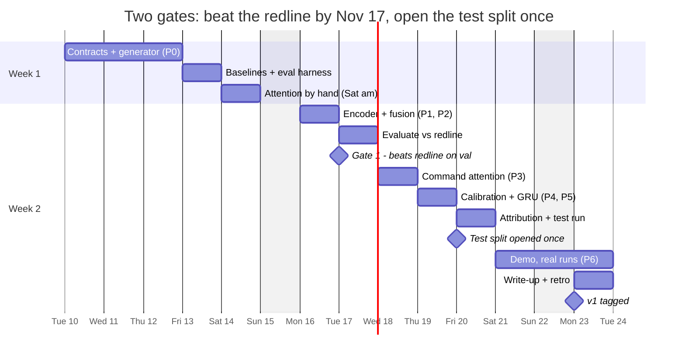
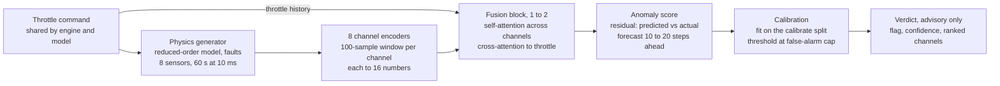

# Rocket Engine Health Orchestrator — Two-Week Build & Learning Plan

Nov 10, 2026 · William Opyrchal

## Where you stand and what two weeks buys

You have a finished design and zero code, so the 30-day, seven-phase plan has to compress to 10 weekdays (9 AM to 5 PM) plus two Saturday mornings (9 AM to 12:30 PM), Tue Nov 10 to Mon Nov 23, about 87 hours, by cutting breadth, never the floor commitments. The repo today holds the design doc and the napkin notes only, five commits. The build log reads 0%.

The win condition for these two weeks is one sentence you can defend with numbers: **on the same held-out synthetic data, the orchestrator catches coupled sub-threshold faults that per-channel redlines miss, at a fixed false-alarm budget, without alarming on commanded throttle changes.** Everything in the plan either produces that sentence or teaches you why it is true.

| Keep (non-negotiable) | Shrink | Defer to roadmap |
| --- | --- | --- |
| Redline baseline on the same data | Faults: bearing wear required (the book's fault), a second type only as a stretch | CNN vibration encoder |
| Disjoint train / val / calibrate / test splits, test touched once | Duty cycle: the book's ramp, hold, shutdown, plus a few mid-run throttle steps | Graph attention over channel topology |
| Uniform per-channel encoders, attention fusion, command cross-attention | Demo: replay real model outputs in the existing Three.js page, not live inference | Graduated response logic |
| Calibrated confidence and an honest attention-vs-ground-truth check | Hyperparameter search: 3 seeds, no sweeps | Higher-fidelity physics |

Decided Nov 10: the model trains on normal data only, so it needs a self-supervised **training objective**. It is forecasting: from a 100-sample window and the throttle history, predict all 8 channels 10 to 20 samples ahead (0.1 to 0.2 s), and use the residual between predicted and actual as the anomaly score. Forecasting forces the model to read the throttle, which is what keeps commanded changes from raising false alarms. The horizon refines the book's one-step version, which a model can pass by copying the last value.

The chart below is the whole two weeks at a glance. The day tables after it carry the detail.

Everything before Gate 1 is about earning a fair comparison. Everything after it is about making that comparison trustworthy and visible.

## Architecture at a glance

v1 is one pipeline: a physics generator feeds eight per-channel encoders, a fusion block weighs the channels against each other and against the throttle history, and a calibrated, advisory verdict comes out. Values below follow the How It Works book. Anything the book leaves open is marked open.

The throttle command is the only input shared by the engine and the model. The injected fault never reaches the model. The redline baseline reads the same telemetry, and the evaluation harness scores both side by side.

**Frozen contracts (D1)**

| Contract | Value | Used by |
| --- | --- | --- |
| Channels, fixed order | `chamber_pressure`, `turbopump_speed`, `turbopump_vibration`, `bearing_temp`, `nozzle_temp`, `coolant_flow`, `feed_pressure`, `mixture_ratio` | generator, encoders, fusion, demo |
| Command | throttle only | generator, cross-attention |
| Run shape | 60 s at 10 ms = 6,000 steps. 1 command + 8 sensors | generator, data loaders |
| Window | 100 samples | encoders |
| Embedding | 16 numbers per channel, so (batch, 8, 16) | encoders to fusion |
| Fusion | 1 to 2 transformer blocks, 4 heads, feed-forward 16 to 64 to 16 | fusion |
| Verdict | flag, confidence, ranked channels | model, evaluation harness, demo |
| Encoder weight sharing | open: decide on D1 | encoders |
| Training objective | forecasting, all 8 channels, 10 to 20 samples ahead (horizon tuned on val) | model, anomaly score |

## How to learn while you build

The fastest way to finish and the deepest way to learn are the same here: build the core by hand, predict before you run, and write down what surprised you. Your build log already has the right instrument, the hand-built / delegated-explainable / delegated-not-understood ledger. This plan just gives it daily rules.

**The daily loop (9:00 to 5:00, with 5:00 to 5:30 as overflow)**

1. **9:00 Prime, 30 min.** Read or watch the one resource tagged for the day. Stop as soon as you can state the idea in two sentences.
2. **9:30 Write the exit test first, 20 min.** Each day ends with a pass/fail test, written before any implementation code, as your build log promises.
3. **Predict, 5 min, before every run.** Write the number you expect in the log. Surprise is where the learning is.
4. **9:50 to 12:30 Build block 1.** Core pieces by hand. Glue delegated (rules below).
5. **12:30 Lunch, away from the screen.** Start a training run before you leave so the machine works while you don't.
6. **1:15 to 4:30 Build block 2.**
7. **4:30 Explain, 30 min.** One build-log entry: what you built, prediction vs result, one thing you could now teach. Anything you can't explain goes in the not-yet-understood column. Commit and tag with the phase id (P0 to P6).
8. **5:00 to 5:30 Overflow only.** Use it to finish the exit test, never to start something new.

**Hand-build vs delegate**

| Build by hand (this is the learning) | Delegate freely, but be able to explain it |
| --- | --- |
| The reduced-order model's equations and fault perturbations | Plotting, CLI, config loading |
| Scaled dot-product attention, once from scratch before using `nn.MultiheadAttention` | Data loaders and batching boilerplate |
| The training loop and the loss | The JSON export and Three.js wiring |
| The evaluation metrics: recall at a false-alarm budget, detection delay | README formatting, CI setup |
| Calibration (temperature scaling, empirical quantile as fallback) | Unit-test scaffolding around your exit tests |

**Rules that protect both the deadline and the learning**

- The not-yet-understood column must be empty at the end of each phase, not just at the end of the project.
- Timebox every rabbit hole to 45 minutes, then write the question down and move on. Physics tuning and Three.js polish are the two likeliest sinks.
- Saturday mornings (9:00 to 12:30) open with a one-hour weekly review: reread the week's log, redo one hand-built piece from memory, update the case study status line. The rest of the morning is one focused block, no new phase starts. Sundays stay off.

## Week 1: data, baseline, and attention by hand (Nov 10 to 14)

Week 1 ends with a trustworthy test bench: a coupled generator, a sub-threshold bearing-wear fault, disjoint splits, a redline baseline to beat, and attention written from scratch. Without the bench, no later number means anything.

| Session | Build | Learn | Exit test (write it first) |
| --- | --- | --- | --- |
| **D1 · Tue Nov 10** — P0 contracts | Repo skeleton (`generator/`, `model/`, `evaluation/`, `tests/`), pytest. Freeze the contracts: the 8 channel names, embedding dim d = 16, window = 100 samples, run shape 60 s at 10 ms (per the book), the `Verdict` dataclass (flag, confidence, implicated channels). Reconcile the docs: add the fifth floor commitment (the verdict must be legible) to design-doc.md and retitle that section "The Five Floor Commitments", canonical Verdict wording, site build log moved from the 30-day plan to this one. Stub README.md (thesis, status, links) and docs/architecture.md (repo layout, frozen contracts, a dated decision log). Repro setup: pinned dependencies, a GitHub Actions job running pytest, a runs/ folder where each run saves config, seed and metrics. | First-order lag systems and time constants. A turbopump-fed engine schematic so each channel maps to hardware. | Contract tests pass: a dummy encoder emits shape (batch, 8, d). A dummy `Verdict` round-trips to JSON, and architecture.md lists every frozen contract. |
| **D2 · Wed Nov 11** — P0 nominal generator | Write the model equations: three dynamic states (turbopump speed, bearing temp, nozzle temp) and five algebraic channels, coupled throttle → pump → feed → flow → thermal (the book's chapter 6). Runs are 60 s at 10 ms, 1 command + 8 sensors. Duty cycle: the book's startup ramp, steady hold and shutdown, plus 1 to 2 mid-run throttle steps in some runs so D7 can test commanded changes (a deliberate addition: log it in the decision log). Noise, channel lag, calibration offsets, run-to-run variation. | Explicit Euler vs `solve_ivp`. Why coupled models produce correlated channels and independent noise does not. | Correlation matrix of nominal runs shows the expected couplings (throttle up raises chamber pressure and pump speed together). Seeded runs reproduce. |
| **D3 · Thu Nov 12** — P0 faults + splits | Inject progressive bearing wear as a rising friction term in the bearing-temperature equation (the book's chapter 7) and tune its onset rate. Stretch, only if done by 3:00: a second fault type, such as a coolant passage partial blockage. Ground-truth labels (onset, perturbed channels). Disjoint train / val / calibrate / test sets from separate seed ranges. | How fault-injection testbeds work. What makes a fault genuinely sub-threshold. | No channel crosses its redline before onset + N s in at least 80% of fault runs. Split seeds never overlap (asserted). |
| **D4 · Fri Nov 13** — Baselines + eval harness | Redline baseline and a per-channel z-score baseline. Harness: recall at a fixed false-alarm budget, detection delay, false alarms during commanded transients. Plots per scenario. Before 5:00, write down the false-alarm budget and final fault magnitudes (fixed before any model exists) and a persistence baseline (next = last value) in the harness, each as a decision-log entry. | ROC vs precision-recall. Why a false-alarm budget is the honest operating point for an advisory system. | Harness reports all three metrics for both baselines on val. The redline misses most coupled faults early (if not, faults are too obvious: retune). |
| **Sat Nov 14 · 9:00–12:30** — Review + attention by hand | 1 h weekly review. Then write scaled dot-product attention from scratch in plain PyTorch tensors and check it matches `nn.MultiheadAttention`. Pure learning block, no deadline pressure. | The Annotated Transformer. Q, K, V. Attention as soft lookup. | Hand-written attention matches the library to 1e-5 on random inputs, masks included. |

## Week 2: model, commands, calibration, and shipping (Nov 16 to 23)

Week 2 builds the model on the bench, then turns a working detector into a defensible result: it beats the redline, stops alarming on throttle changes, reports confidence that means something, and shows up in the demo. The test split is opened exactly once, on Fri Nov 20.

| Session | Build | Learn | Exit test (write it first) |
| --- | --- | --- | --- |
| **D5 · Mon Nov 16** — P1 + P2 model | Morning: walking skeleton, one uniform encoder (small MLP or 1-D conv), one channel, one fault, through to a `Verdict`. Afternoon: encoders for all 8 channels, shared or separate per the D1 decision, with channel-ID embeddings, fusion as a transformer block (4-head self-attention, feed-forward 16 to 64 to 16, residuals, normalization), forecasting objective, starting at a 10-sample horizon. Anomaly score = normalized residual. Last 30 min: fill the pipeline section of architecture.md (generator → encoders → fusion → verdict). | Embeddings in a shared space. How a prediction residual becomes an anomaly score. | End-to-end verdict on one fault. Loss falls on nominal data. Forecast error clearly beats the persistence baseline on held-out nominal runs. Fault residuals rise. |
| **D6 · Tue Nov 17** — P2 evaluate | Train 3 seeds. Run the harness against both baselines on val. Log the numbers. | Reading training curves. Variance across seeds. | **Gate 1:** fused model beats the redline on coupled-fault recall at the same false-alarm budget on val. Miss it → spend D7 fixing and drop the GRU experiment. |
| **D7 · Wed Nov 18** — P3 command awareness | Encode the last K throttle setpoints (the only command) as a sequence. Add cross-attention inside the fusion block from channel tokens (queries) to command tokens (keys/values). Ablate: same model without commands. | Cross-attention vs self-attention. Why commands get structural priority instead of being extra input channels. | False alarms during commanded throttle steps drop vs the ablation, with coupled-fault recall no worse. |
| **D8 · Thu Nov 19** — P4 calibration + P5 experiment | Morning: temperature scaling on the calibrate split (the book's choice), then check it against your definition that 0.85 means "more unusual than 85% of normal examples". If they disagree, an empirical quantile is the fallback, logged as a decision. Set the alarm threshold from the false-alarm budget. Afternoon: your first open question, GRU over the command history vs cross-attention, 3 seeds each, prediction written first. | Calibration vs accuracy. Split conformal prediction. Recurrence vs attention for dynamics. | Held-out nominal share above q is within ±3 points of 1 − q for q = 0.8, 0.9, 0.95. Experiment table with mean ± spread and a one-paragraph verdict. |
| **D9 · Fri Nov 20** — Attribution + the one test run | Compare top-k attention weights to each fault's ground-truth perturbed channels, and to per-channel residual attribution. Freeze the model, run the test split once, record final numbers. | Attention is not explanation, and the rebuttal. Top-k overlap as a metric. | Final test table: orchestrator vs redline vs z-score on recall at budget, detection delay, transient false alarms, attribution overlap. No retraining after this. |
| **Sat Nov 21 · 9:00–12:30** — Review + demo data | 1 h weekly review. Then export verdict traces (scores, confidence, attention weights, channel values) from real test runs to JSON in the shape the demo needs. | Keeping the most visible artifact honest: the demo shows the system that exists. | At least one exported coupled-fault run where the verdict forms before any redline trips. |
| **D10 · Mon Nov 23** — P6 demo + ship | Morning: replace the demo's scripted scenarios with replay of the exported traces. Update the tour narration. Afternoon: README finished (thesis, status, quickstart, results table, links to the case study and both docs), architecture.md checked against the final code, Results section in the design doc, case-study status line updated to real numbers, build log current, v1 tag. Last 30 min: retrospective and a no-notes teach-back. | Writing results a skeptic can check: what was held out, what was tuned. | A stranger can clone, run one command, and reproduce the val numbers. The not-yet-understood column is empty. |

## Done, risks, and what to cut

v1 is done when every box below is ticked. If you fall behind, cut from the bottom of the cut list and never touch the floor commitments.

**Definition of done**

- [ ] Final test-split table shows the orchestrator beating the redline on coupled-fault recall at the same false-alarm budget
- [ ] Commanded throttle steps cause fewer false alarms with command cross-attention than without
- [ ] Calibration check passes on held-out nominal data
- [ ] Attribution overlap reported, framed as relevance, not cause
- [ ] Demo replays real exported runs
- [ ] Repo reproduces the val numbers from one command
- [ ] Ledger's not-yet-understood column is empty

**Risks**

| Risk | Early sign | Response |
| --- | --- | --- |
| Faults too obvious or too faint | D4: redline catches everything, or later the model catches nothing | Retune fault magnitudes on val only. One 45-min timebox, then pick the middle setting |
| Physics model eats week 1 | D2 runs past 5:30 | Freeze at "plausible and coupled". Fidelity is a stated roadmap item |
| Training unstable or residuals noisy | D5 loss does not settle | Normalize per channel, shrink d to 8, smooth the score over a short window |
| Peeking at the test split | Any urge to "just check" before D9 | The split loader asserts a flag that only the D9 script sets |
| D8 overloaded (calibration + experiment) | Calibration not passing by lunch | Drop the GRU experiment first (cut list item 1) |
| Demo polish rabbit hole | D10 demo work runs past lunch | Ship one real scenario. Polish is post-v1 |

**Cut list (cut from the top first)**

1. The GRU experiment on D8 (state it as the first open question in the writeup)
2. The stretch second fault (bearing wear stays)
3. The z-score baseline (keep the redline)
4. Demo integration (ship static plots of a real run instead)

Never cut: the redline comparison, disjoint splits, the single test run, calibration.

## Learning resources by phase

One resource per day is enough. Read only until you can state the idea in two sentences, then build.

| Session | Resource | Why this one |
| --- | --- | --- |
| D1–D2 | Sutton & Biblarz, *Rocket Propulsion Elements*, the liquid-propellant feed system and turbopump chapters | Gives each of your 8 channels a physical meaning and plausible couplings |
| D3 | NASA's work on Space Shuttle Main Engine health monitoring (search "SSME Advanced Health Management System") | The real-world version of your problem, including why redlines dominate |
| D4 | Any good primer on precision-recall vs ROC for rare events | Sets up the false-alarm-budget framing your harness uses |
| Sat Nov 14 | [The Annotated Transformer](https://nlp.seas.harvard.edu/annotated-transformer/) and Karpathy's "Let's build GPT from scratch" video | Attention written line by line. The model for your hand-built version |
| D5 | [Anomaly Transformer, Xu et al. 2021](https://arxiv.org/abs/2110.02642) | Attention-based multivariate time-series anomaly detection, close to your design |
| D8 | [Guo et al. 2017, On Calibration of Modern Neural Networks](https://arxiv.org/abs/1706.04599) and [Angelopoulos & Bates, A Gentle Introduction to Conformal Prediction](https://arxiv.org/abs/2107.07511) | Temperature scaling vs conformal: the choice you make that morning |
| D9 | [Jain & Wallace 2019, Attention is not Explanation](https://arxiv.org/abs/1902.10186) and [Wiegreffe & Pinter 2019, Attention is not not Explanation](https://arxiv.org/abs/1908.04626) | The debate behind your third floor commitment |
| Post-v1 | [Deng & Hooi 2021, Graph Neural Network-Based Anomaly Detection in Multivariate Time Series (GDN)](https://arxiv.org/abs/2106.06947) | The closest published version of your graph-attention roadmap rung |
